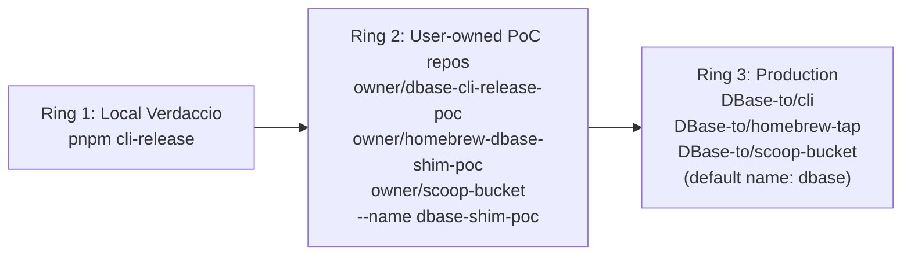
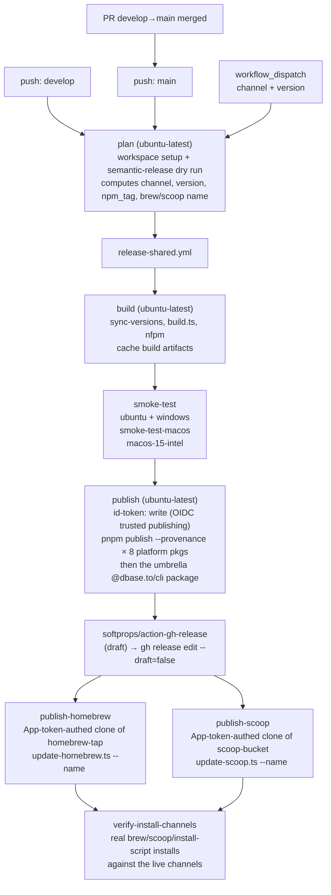

# Release Process

This document is the operational playbook for releasing the DBase CLI. It
covers three environments ("rings"):

1. **Ring 1 — Local Verdaccio.** Fastest feedback loop. Build and install the
   CLI from a local npm registry on your own machine. No network side-effects;
   no repo pushes.
2. **Ring 2 — User-owned PoC repos.** End-to-end validation through the same
   Homebrew / Scoop / GitHub-Release code paths production uses, but pointed at
   a reviewer's own GitHub account and a non-`dbase` artifact name. This is how
   the local and PoC rings validate the release before production.
3. **Ring 3 — Production.** The `@dbase.to/cli` npm package +
   `DBase-to/homebrew-tap` + `DBase-to/scoop-bucket` + GitHub Releases on
   `DBase-to/cli`. Driven by GitHub Actions (`release.yml`, which dispatches
   `beta` and `stable` into `release-shared.yml`).



Move outward one ring at a time. Only promote to production after Ring 2 has
exercised the full channel end-to-end on a fresh machine.

## First release checklist

Before the first production cut:

- [ ] `main` exists. The stable channel and the install-script URL
      (`raw.githubusercontent.com/DBase-to/cli/main/install`) both require it.
      Create it from `develop` before the first stable release.
- [ ] The `@dbase.to` npm organization owns the scope and all nine package
      names are available: `@dbase.to/cli` plus the eight
      `@dbase.to/cli-<platform>` binary packages. The unscoped `dbase` name is
      owned by an unrelated package.
- [ ] Each of the nine packages has a trusted publisher configured for the
      **calling** workflow, `release.yml`. npm validates the calling workflow for
      `workflow_call`, not `release-shared.yml`. The very first publish of a
      new package needs a granular `NPM_TOKEN` repository secret with publish
      access to the `@dbase.to` organization, because the trusted-publisher
      settings page only exists after the package exists; remove the secret
      afterwards.
- [ ] `DBase-to/homebrew-tap` and `DBase-to/scoop-bucket` exist. They do; keep
      `publish_brew_scoop=false` until the GitHub App has `contents: write` on
      both, because with `true` and a missing app grant every release fails at
      the tap/bucket push after npm has already published.
- [ ] A `dry_run=true` dispatch is green, including the macOS smoke legs.
- [ ] Only then set the repository variable `RELEASE_ENABLED=true`.

---

## Ring 1 — Local Verdaccio

Use this loop while iterating on build scripts, the Node shim, or anything that
changes what gets packed into `@dbase.to/cli` or `@dbase.to/cli-<platform>`. It installs
the CLI into a local npm registry and lets you
`npx --registry http://localhost:4873 @dbase.to/cli` as if you'd installed from npm.

Start the registry in one terminal:

```sh
pnpm local-registry
```

Publish the CLI into it from another terminal (current platform only, faster
than a cross-platform build):

```sh
# CLI (Bun single-file executable; run `pnpm repos:install` once for Effect types):
pnpm cli-release
```

Test it:

```sh
npx --registry http://localhost:4873 @dbase.to/cli@<printed-version> --version
```

[`tools/release/local-release.ts`](../../../tools/release/local-release.ts)
does the heavy lifting: it builds the platform binary and the umbrella
`@dbase.to/cli` package, materialises them in a tmp dir (so no workspace
`package.json` is modified), and publishes both to Verdaccio. Cleanup is
automatic even on failure.

This is the right ring for:

- Debugging the Node shim
  ([`apps/cli/src/shared/cli/bin.ts`](../src/shared/cli/bin.ts)) — which
  platform package gets resolved, `execFileSync` behaviour.
- Reproducing a `dbase`-from-npm experience without touching any remote.
- Verifying `SUPABASE_CLI_VERSION` injection propagates to `--version` output.

It is **not** a valid test for Homebrew or Scoop — those paths are covered in
Ring 2.

---

## Ring 2 — Testing uploads with user-owned repos

This validates the Homebrew formula, Scoop manifest, and GitHub-Release-host
resolution on real infrastructure without touching `DBase-to/` repositories or
clashing with an already-installed `dbase` CLI on the reviewer's machine.

Both updater scripts support a `--name <custom>` flag that pushes the formula /
manifest under a different name (e.g., `dbase-shim-poc`) — a different filename
and Ruby class / Scoop manifest. The installed binary is always `dbase`, so a
PoC reviewer should `brew uninstall dbase` / `scoop uninstall dbase` first if
they already have a DBase CLI installed.

### One-time setup (per reviewer)

Create three empty repos on your own GitHub account:

| Purpose                      | Repo name constraint                                                         | Example                           |
| ---------------------------- | ---------------------------------------------------------------------------- | --------------------------------- |
| GitHub Release artifact host | None                                                                         | `<owner>/dbase-cli-release-poc`   |
| Homebrew tap                 | Must be named `homebrew-<anything>` (so `brew tap <owner>/<anything>` works) | `<owner>/homebrew-dbase-shim-poc` |
| Scoop bucket                 | None                                                                         | `<owner>/scoop-bucket`            |

All three can be empty git trees. The updater scripts clone the Homebrew tap /
Scoop bucket into a tmpdir with git, write their generated file, commit, and
push.

Authenticate the GitHub CLI once with write access to all three:

```sh
gh auth login
gh auth status  # verify: ✓ Logged in to github.com account <you>
```

### Dry-run: generate artifacts without pushing

The `--dry-run` flag on both updater scripts produces `Formula/<name>.rb` and
`<name>.json` in `dist/` and prints them, without cloning or pushing to the
tap/bucket.

```sh
# Build all eight platform archives + linux packages + checksums.txt.
# Builds the Bun single-file executables.
bun apps/cli/scripts/build.ts --version 0.0.1

# Render the Homebrew formula against your PoC release host + tap.
bun apps/cli/scripts/update-homebrew.ts --version 0.0.1 \
    --repo <owner>/dbase-cli-release-poc \
    --tap <owner>/homebrew-dbase-shim-poc \
    --name dbase-shim-poc \
    --dry-run

# Render the Scoop manifest against your PoC release host + bucket.
bun apps/cli/scripts/update-scoop.ts --version 0.0.1 \
    --repo <owner>/dbase-cli-release-poc \
    --bucket <owner>/scoop-bucket \
    --name dbase-shim-poc \
    --dry-run
```

Inspect `dist/dbase-shim-poc.rb` and `dist/dbase-shim-poc.json`. The `sha256` /
`hash` fields resolve against `dist/checksums.txt`; the `url` fields point at
`https://github.com/<owner>/dbase-cli-release-poc/releases/download/v0.0.1/...`
(the release host specified by `--repo`).

### Upload the GitHub Release

The updater scripts do **not** create the GitHub Release or upload `dist/*` — in
production that is `release-shared.yml`'s `publish` job. For a PoC run, do it
manually with `gh release create`:

```sh
gh release create v0.0.1 \
    --repo <owner>/dbase-cli-release-poc \
    --title "v0.0.1" \
    --notes "Ring 2 validation release" \
    dist/dbase_0.0.1_darwin_arm64.tar.gz \
    dist/dbase_0.0.1_darwin_amd64.tar.gz \
    dist/dbase_0.0.1_linux_arm64.tar.gz \
    dist/dbase_0.0.1_linux_amd64.tar.gz \
    dist/dbase_0.0.1_linux_arm64.deb \
    dist/dbase_0.0.1_linux_amd64.deb \
    dist/dbase_0.0.1_linux_arm64.rpm \
    dist/dbase_0.0.1_linux_amd64.rpm \
    dist/dbase_0.0.1_linux_arm64.apk \
    dist/dbase_0.0.1_linux_amd64.apk \
    dist/dbase_0.0.1_windows_amd64.zip \
    dist/dbase_0.0.1_windows_arm64.zip \
    dist/checksums.txt
```

### Push formula + manifest to PoC tap / bucket

Rerun the updater scripts without `--dry-run`. They clone the target repo into a
tmpdir, write the new file, commit with message `<name> <version>`, and push.

```sh
bun apps/cli/scripts/update-homebrew.ts --version 0.0.1 \
    --repo <owner>/dbase-cli-release-poc \
    --tap <owner>/homebrew-dbase-shim-poc \
    --name dbase-shim-poc

bun apps/cli/scripts/update-scoop.ts --version 0.0.1 \
    --repo <owner>/dbase-cli-release-poc \
    --bucket <owner>/scoop-bucket \
    --name dbase-shim-poc
```

### User-side install commands

These are what a fresh reviewer would run — no repo clone required.

**macOS / Linux (Homebrew):**

```sh
brew uninstall dbase || true          # the PoC formula installs a `dbase` binary too
brew tap <owner>/dbase-shim-poc       # note: "<owner>/<tap-suffix>", not the full repo name
brew install dbase-shim-poc
dbase --version                       # expect: dbase v0.0.1
brew test dbase-shim-poc              # expect: pass
```

The `brew tap <owner>/<suffix>` command looks up
`https://github.com/<owner>/homebrew-<suffix>`. That is why the tap repo must be
named `homebrew-dbase-shim-poc`, not just `dbase-shim-poc`.

**Windows (Scoop):**

```powershell
scoop uninstall dbase   # the PoC manifest also shims `dbase.exe`
scoop bucket add <owner>-poc https://github.com/<owner>/scoop-bucket
scoop install dbase-shim-poc
dbase --version         # expect: dbase v0.0.1
```

### What to validate

Beyond `--version` and `brew test`, confirm the binary runs. `dbase --version`
only proves the launcher works, so also exercise the command tree:

```sh
dbase --help
dbase status --help
```

If the binary is missing, check that
[`update-homebrew.ts`](../scripts/update-homebrew.ts)'s install block installed
`dbase`, and that the built archive actually contains it (it should, for any
release build).

### Local-artifact testing (no GitHub Release upload)

Both updater scripts also support `--local`, which generates a formula/manifest
pointing at `file://$PWD/dist/...` instead of a GitHub URL:

```sh
bun apps/cli/scripts/update-homebrew.ts --version 0.0.1 \
    --name dbase-shim-poc --local --dry-run > /tmp/dbase-shim-poc.rb

brew install --build-from-source /tmp/dbase-shim-poc.rb
```

```powershell
bun apps/cli/scripts/update-scoop.ts --version 0.0.1 `
    --name dbase-shim-poc --local --dry-run
# Copy the JSON from dist/dbase-shim-poc.json, then:
scoop install .\dist\dbase-shim-poc.json
```

---

## Ring 3 — Production release flow

Production releases live in
[`.github/workflows/release.yml`](../../../.github/workflows/release.yml), which
dispatches two channels into
[`release-shared.yml`](../../../.github/workflows/release-shared.yml):

| Channel | Trigger              | npm dist-tag | brew/scoop name | GH release | Version        |
| ------- | -------------------- | ------------ | --------------- | ---------- | -------------- |
| beta    | push: develop        | beta         | dbase-beta      | prerelease | `X.Y.Z-beta.N` |
| stable  | push: main (post-FF) | latest       | dbase           | latest     | `X.Y.Z`        |

`beta` publishes on every merge to `develop` that produces a releasable commit.
`stable` publishes after a reviewed `develop` → `main` PR is merged (the push to
`main` fires `release.yml` via `push: branches: [main]`).

Beta + stable versions are computed by `cycjimmy/semantic-release-action` from
the first line of each squash commit (the PR title). Conventional commit titles
use `feat:` → minor, `fix:`, `perf:`, or `revert:` → patch, and `!` after the
type or scope (`feat!:` / `fix(scope)!:`) → major. Commit bodies, including
`BREAKING CHANGE` notes, are ignored for version calculation. The `release`
config lives in `apps/cli/package.json` and uses `prerelease: beta` on
`develop`, so develop pushes emit `X.Y.Z-beta.N` and main pushes emit `X.Y.Z`.



### Trigger

Automatic releases are disabled until the repository variable
`RELEASE_ENABLED` is set to `true`. With the gate off, pushes still run tests but
the release job is skipped. `workflow_dispatch` always runs, so the first release
can be a dry run.

When the gate is on, merging into `develop` computes a beta and pushing to `main`
computes a stable release. Hotfixes use the same production gate: a reviewed
`hotfix/*` PR targets `main`, and the resulting `main` push triggers the stable
release path. For a one-off override, dispatch manually:

```sh
# Manual beta or stable override (operator-supplied version):
gh workflow run release.yml \
    --field channel=beta \
    --field version=0.0.0-beta.99 \
    --field dry_run=true
```

Auto-trigger paths leave `version` empty: semantic-release computes it from
commits since the last tag.

### Hotfix release flow

Use a hotfix when an urgent stable fix must ship before the next scheduled
`develop` → `main` promotion. The hotfix path deliberately reuses the production
PR gate instead of adding a second approval mechanism:

1. Branch from the current `main` tip:

   ```sh
   git fetch origin main
   git switch -c hotfix/<short-description> origin/main
   ```

2. Make the smallest safe fix and open a PR from `hotfix/<short-description>`
   into `main`.
3. Before merging, run a release dry run against the hotfix branch and the next
   unique stable version:

   ```sh
   gh workflow run release.yml \
       --ref hotfix/<short-description> \
       --field channel=stable \
       --field version=<next-patch-version> \
       --field dry_run=true
   ```

4. After review and green checks, merge the hotfix PR into `main`. The
   `push: main` trigger runs the normal stable release pipeline and publishes
   the next semantic-release version.
5. Watch the stable release workflow through publish, Homebrew/Scoop updates,
   and verification.
6. Confirm that `Sync main to develop` succeeds. That workflow merges `main`
   back into `develop` after a successful `Release` run on `main`, keeping the
   hotfix reachable from the next beta and the next scheduled production deploy.
   If the sync conflicts, resolve it with a follow-up PR into `develop`.

Do not use `workflow_dispatch dry_run=false` as the normal hotfix path. Manual
stable dispatch is reserved for re-cutting a unique version after an interrupted
or stale-bytes release.

### What each job does

**`plan` (ubuntu-latest):**

1. Installs the workspace. semantic-release resolves its `plugins` list from
   `apps/cli`, which includes the local analyse script and
   `@semantic-release/release-notes-generator`.
2. Runs `cycjimmy/semantic-release-action` in dry-run mode to compute the next
   version, npm tag, prerelease flag, and brew/scoop names. A
   `workflow_dispatch` supplies those values directly instead.

**`build` (ubuntu-latest):**

1. [`sync-versions.ts`](../scripts/sync-versions.ts) writes the release version
   into every `package.json` (umbrella + eight platform packages).
2. [`build.ts`](../scripts/build.ts) cross-compiles the Bun SFE for all eight
   targets (including windows-arm64), ad-hoc signs the macOS binaries (see [Code signing (macOS)](#code-signing-macos)),
   builds the Linux packages via `nfpm`, produces the tar/zip archives, and
   writes `dist/checksums.txt`.
3. The build artifacts are cached for the downstream jobs.

**`smoke-test` (ubuntu + windows) and `smoke-test-macos` (macos-latest):**

Download the build artifacts, make the binaries executable, install Scoop on
Windows, and run `pnpm run test:smoke -- --version X.Y.Z --tag <latest|beta>`.
The macOS leg also verifies each binary's signature (`codesign --verify
--strict`, correct identifier, not linker-signed) and executes `dbase
--version`, which is the real AMFI gate. Any failure blocks publishing.

**`publish` (ubuntu-latest, `if: !inputs.dry_run`):**

1. Re-runs `sync-versions.ts` (the cache restores file modes but not the JSON
   mutations).
2. [`publish.ts`](../scripts/publish.ts) publishes the eight platform packages
   via OIDC trusted publishing (`pnpm publish --provenance`). The very first
   publish of a new package needs the `NPM_TOKEN` secret; later publishes use
   the trusted publisher. The umbrella package goes last so
   `optionalDependencies` resolve cleanly at install time.
3. Pushes the version tag to `origin`, then attaches a channel note for
   prerelease tags so semantic-release keeps computing forward versions.
4. `softprops/action-gh-release` creates a **draft** Release `v<version>` on
   `DBase-to/cli` with all tar / zip / deb / rpm / apk + `checksums.txt` and
   the `install` script.
5. `gh release edit v<version> --draft=false` finalises it (immutable from this
   point).

### Post-publish: Homebrew + Scoop

Both updaters run automatically from `release-shared.yml`'s
`publish-homebrew` and `publish-scoop` jobs after the GitHub Release is
finalised. Each job mints a GitHub App token scoped to `homebrew-tap` /
`scoop-bucket`, runs `gh auth setup-git`, sets a `github-actions[bot]` git
identity, then invokes [`update-homebrew.ts`](../scripts/update-homebrew.ts) /
[`update-scoop.ts`](../scripts/update-scoop.ts) with `--name <brew_name>` /
`--name <scoop_name>`:

- `stable` → `--name dbase`
- `beta` → `--name dbase-beta`

The jobs are gated by the `publish_brew_scoop` input. It stays `false` until
`DBase-to/homebrew-tap` and `DBase-to/scoop-bucket` exist; with `true` and
missing repositories, the release fails after npm has published.

### Post-publish: install-channel verification

Once the channels are live,
[`verify-install-channels.yml`](../../../.github/workflows/verify-install-channels.yml)
(`verify-install-channels` job) runs last and is non-gating: by the time it
runs, the artifacts are already published, so a failure surfaces as a red
post-release signal rather than blocking distribution.

It performs a **real** `brew install` (macOS **and** Linux, so both the
`on_macos` and `on_linux` stanzas of the formula are exercised), a `scoop
install`, and a `curl | bash` install of the **published** install script
(fetched from the release asset, not the repo checkout). Each leg asserts
`dbase --version` matches and that `dbase --help` lists commands, so a package
that omits or misplaces the binary fails too. brew, scoop, and
the install script each verify the published `sha256`/`hash` against the
downloaded tarball.

It runs only for `beta`/`stable` when `publish_brew_scoop` is true and both
pushes succeeded, and can be dispatched manually against any already-published
version from the Actions tab.

### Code signing (macOS)

The macOS binaries (`dbase`, `darwin-arm64` and `darwin-x64`) are signed inside `build.ts` between compilation and archiving, so
the signed bytes flow into every channel that consumes
`packages/cli-darwin-*/bin/` — npm platform packages, Homebrew, and the GitHub
Release tarballs (which also feed the `install` script).

Why this exists: `bun build --compile` emits only a degenerate
"linker-signed" ad-hoc signature (identifier `a.out`, no requirements blob).
macOS 26+ AMFI rejects it and SIGKILLs the process at launch ( /
[#5556](https://github.com/supabase/cli/issues/5556)). A full ad-hoc signature
fixes it.

- **Signing runs on the Linux build runner** via
  [`rcodesign`](https://github.com/indygreg/apple-platform-rs) (the
  apple-codesign project), which signs Mach-O binaries without a macOS host. No
  macOS signing job exists, and **no Apple credentials are required for the
  current ad-hoc signing** (Phase 1). The version + sha256 are pinned in the
  "Install rcodesign" step of
  [`build-cli-artifacts.yml`](../../../.github/workflows/build-cli-artifacts.yml).
- **CI hard-fails if signing is unavailable**: the build job sets
  `DBASE_CLI_REQUIRE_SIGNING=1`, so a missing `rcodesign` fails the build
  rather than silently shipping unsigned binaries. Local builds without
  `rcodesign` degrade to a warning and skip signing.
- **Validation gate (required before every production cut):** signing is
  produced on Linux, so it must be _proven_ on a real Mac before publishing.
  This is automatic — `publish` depends on both smoke jobs, and the macOS smoke
  leg checks the signature and runs the binary; a bad signature fails
  smoke-test and blocks publish.

  ```sh
  gh workflow run release.yml --field channel=beta --field version=0.0.0-beta.99 --field dry_run=true
  # Watch the run; the macOS smoke-test leg must pass. `dry_run=true` runs build
  # + smoke (signature verification + `dbase --version`) but skips publish.
  ```

  Do not promote a real (`dry_run=false`) release until a dry run on the same
  commit has shown the macOS smoke leg green.

> **Phase 2 (Developer ID + notarization)** is not yet enabled. It only matters
> for the _direct-download_ path (a quarantined `.tar.gz`/`.zip` from the
> GitHub Release), not for Homebrew/npm/Scoop. It will be added behind Apple
> credential secrets.

### Verification

The `verify-install-channels` workflow automates the manual checks below for the
brew/scoop/install-script channels; the steps remain useful for a manual sanity
check or for the npm/provenance bits the workflow does not cover. After
`release-shared.yml` finishes:

```sh
npm view dbase@0.1.0 dist-tags   # expect: latest: 0.1.0 (or beta: 0.1.0-beta.N)
gh release view v0.1.0 --repo DBase-to/cli

# macOS / Linux:
brew update && brew upgrade dbase   # or: brew install dbase-beta
dbase --version                     # expect: dbase v0.1.0

# Windows:
scoop update
scoop install dbase                 # or: scoop install dbase-beta
dbase --version                     # expect: dbase v0.1.0
```

The npm package page should also show **Provenance** linking back to
`DBase-to/cli` + `release.yml` (OIDC-attested build).

### Rollback

The per-channel artifacts are immutable once published, so rollback = point
users at the previous good version:

1. **npm:** `npm dist-tag add dbase@<prev-good-version> latest`. The broken
   version stays installable but loses the `latest` tag.
2. **GitHub Release:** `gh release delete v<broken-version> --repo DBase-to/cli`
   (or mark it `prerelease: true` via `gh release edit` to keep the tag around).
   Artifacts remain downloadable unless the release itself is deleted.
3. **Homebrew:** in `DBase-to/homebrew-tap`, `git revert <commit that wrote
Formula/dbase.rb for the broken version>` + push. `brew update` picks it up.
4. **Scoop:** same pattern in `DBase-to/scoop-bucket` — `git revert` the
   manifest commit.

Rollback is straightforward because each channel is its own commit / release.
There is no cross-channel state to reconcile.

---

## See Also

- [`apps/cli/docs/binary-distribution.md`](./binary-distribution.md) — how each
  platform package ships and resolves its binary at runtime.
- [`tools/release/local-release.ts`](../../../tools/release/local-release.ts) —
  Ring 1 implementation.
- [`apps/cli/scripts/build.ts`](../scripts/build.ts),
  [`publish.ts`](../scripts/publish.ts),
  [`sync-versions.ts`](../scripts/sync-versions.ts),
  [`update-homebrew.ts`](../scripts/update-homebrew.ts),
  [`update-scoop.ts`](../scripts/update-scoop.ts) — release script
  implementations.
- [`.github/workflows/release.yml`](../../../.github/workflows/release.yml),
  [`release-shared.yml`](../../../.github/workflows/release-shared.yml) — Ring 3
  pipeline.
